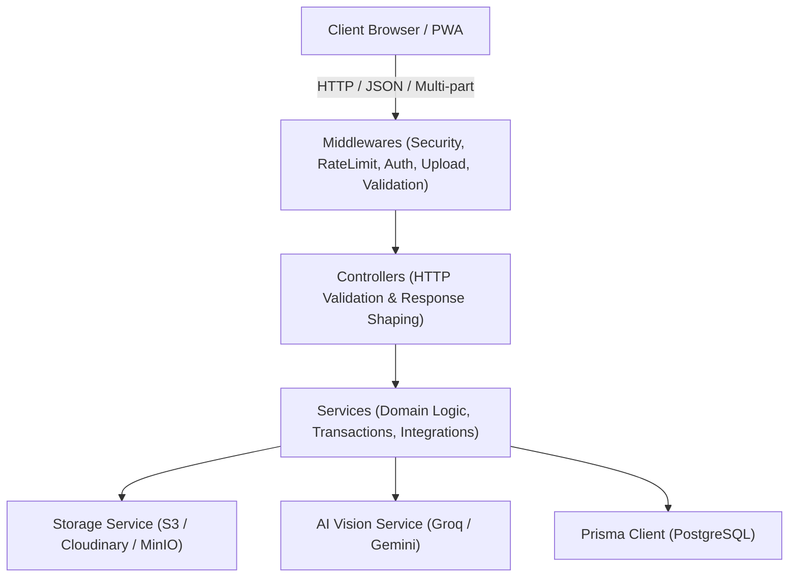
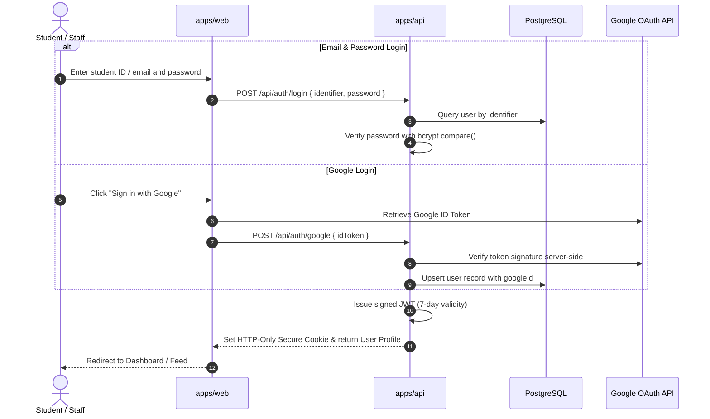
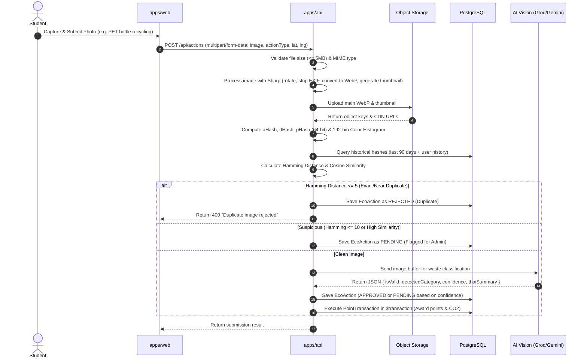
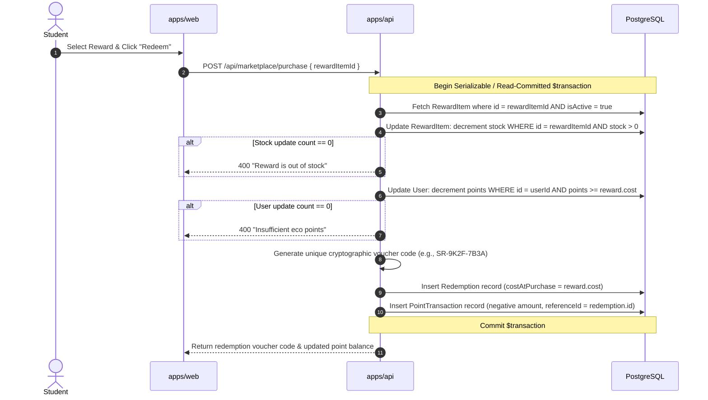
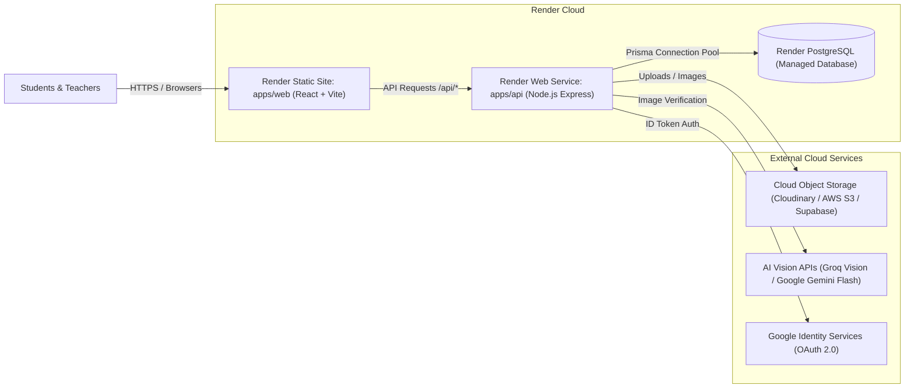

# System Architecture: SaveRaks

**Document Reference:** `docs/ARCHITECTURE.md`  
**Date & Time:** October 28, 2026, 22:30:00 +07:00 (Asia/Bangkok)  
**Author:** Technical Lead & Principal Software Architect  
**Status:** Approved Architectural Blueprint  

---

## 1. Architectural Style & Philosophy

SaveRaks is engineered as a **Modular Monolith** organized within a `pnpm` workspace monorepo. 

### Why a Modular Monolith?
- **Avoids Premature Microservices:** A single, well-structured deployment unit eliminates network latency, distributed transaction complexities (Sagas / 2PC), and complex orchestration overhead.
- **Strict Domain Boundaries:** Each capability (Auth, Actions, Anti-Cheat, Storage, Marketplace, Leaderboard, Map, Admin) is isolated into cohesive feature modules with explicit contracts.
- **Shared Domain Truth:** Domain constants (action point values, CO2 emission formulas, commute time rules, and validation schemas) reside in a single shared package (`packages/shared`), eliminating configuration drift between frontend and backend.
- **Native JavaScript ES Modules (ESM):** All packages and services use pure JavaScript ES Modules (`"type": "module"`). TypeScript is avoided by default in accordance with project non-negotiables, while strong runtime validation (via Zod / schema validators) ensures contract safety.

---

## 2. Monorepo Structure

```text
D:\Project_SaveRaks/
├── package.json                 # Monorepo root manifest (pnpm workspaces, root scripts)
├── pnpm-workspace.yaml          # Workspace package mapping
├── .gitignore                   # Git ignore rules (node_modules, .env, dist, uploads)
├── .dockerignore                # Container build exclusions
├── .env.example                 # Safe environment template with dummy values
├── render.yaml                  # Declarative Infrastructure-as-Code for Render
├── docs/                        # Complete system specifications & operational guides
│   ├── PROJECT_AUDIT.md
│   ├── ARCHITECTURE.md
│   ├── FEATURE_SPECIFICATION.md
│   ├── DATA_MODEL.md
│   ├── SECURITY_PLAN.md
│   ├── TEST_PLAN.md
│   ├── RENDER_DEPLOYMENT.md
│   └── IMPLEMENTATION_ROADMAP.md
├── packages/
│   └── shared/                  # Single Source of Truth for constants, rules & schemas
│       ├── package.json         # ("@saveraks/shared", type: "module")
│       └── src/
│           ├── index.js         # Package export entry point
│           ├── constants.js     # Points, CO2 rates, commute windows, level thresholds
│           └── schemas.js       # Runtime input validation schemas
├── apps/
│   ├── api/                     # Node.js + Express backend service
│   │   ├── package.json         # ("@saveraks/api", type: "module")
│   │   ├── prisma/
│   │   │   ├── schema.prisma    # Authoritative PostgreSQL schema
│   │   │   ├── migrations/      # Version-controlled SQL migrations
│   │   │   └── seed.js          # Deterministic database seeder
│   │   └── src/
│   │       ├── server.js        # HTTP server listener & graceful shutdown
│   │       ├── app.js           # Express application configuration & pipeline
│   │       ├── config/          # Environment fail-fast parsing, DB, Redis, Storage
│   │       │   ├── env.js
│   │       │   ├── prisma.js
│   │       │   ├── storage.js
│   │       │   └── redis.js
│   │       ├── middlewares/     # Auth, rate limiting, file upload, error handling
│   │       │   ├── auth.middleware.js
│   │       │   ├── rbac.middleware.js
│   │       │   ├── upload.middleware.js
│   │       │   ├── rateLimit.middleware.js
│   │       │   └── error.middleware.js
│   │       ├── services/        # Business logic & external adapters
│   │       │   ├── auth.service.js
│   │       │   ├── storage.service.js
│   │       │   ├── anticheat.service.js
│   │       │   ├── ai-vision.service.js
│   │       │   ├── points.service.js
│   │       │   └── marketplace.service.js
│   │       ├── controllers/     # HTTP request/response handlers
│   │       │   ├── auth.controller.js
│   │       │   ├── actions.controller.js
│   │       │   ├── marketplace.controller.js
│   │       │   ├── leaderboard.controller.js
│   │       │   ├── pins.controller.js
│   │       │   └── admin.controller.js
│   │       └── routes/          # API route definitions
│   │           └── index.js
│   └── web/                     # React + Vite frontend application
│       ├── package.json         # ("@saveraks/web", type: "module")
│       ├── index.html           # HTML entry point
│       ├── vite.config.js       # Vite configuration (PWA, Tailwind, proxies)
│       ├── tailwind.config.js   # Tailwind design tokens & theme configuration
│       └── src/
│           ├── main.jsx         # React application bootstrap
│           ├── App.jsx          # Router & Providers
│           ├── api/             # API client & fetch abstractions
│           ├── hooks/           # Custom React hooks (auth, query, media)
│           ├── components/      # UI components (Button, Modal, Card, Navbar)
│           └── pages/           # Screen views (Home, Login, Vision, Shop, Admin)
└── tests/
    └── e2e/                     # End-to-end integration tests (Playwright)
        ├── package.json
        ├── playwright.config.js
        └── specs/
```

---

## 3. Layered Backend Architecture (`apps/api`)

The backend follows an explicit four-layer architecture with unidirectional dependencies:



### 3.1 Layer Responsibilities
1. **Middlewares:**
   - `rateLimit.middleware.js`: Protects against brute-force attacks and denial-of-service.
   - `auth.middleware.js`: Validates JWT session tokens from HTTP-only cookies or `Authorization` headers.
   - `rbac.middleware.js`: Enforces role-based permissions (`STUDENT`, `STAFF`, `ADMIN`).
   - `upload.middleware.js`: Uses `multer.memoryStorage()` with strict 5 MB file size limit and MIME-type magic byte validation (`image/jpeg`, `image/png`, `image/webp`).
   - `validate.middleware.js`: Intercepts and parses request payloads against Zod schemas before touching controllers.
2. **Controllers:**
   - Receive verified HTTP requests.
   - Extract parameters, headers, and validated DTOs.
   - Delegate business logic execution to domain services.
   - Return normalized JSON responses (`{ success: true, data: ... }` or `{ success: false, error: ... }`).
3. **Services:**
   - Contain all business logic and invariants.
   - Execute database operations inside atomic transactions (`prisma.$transaction`).
   - Coordinate external integrations (AI Vision, Object Storage, Google OAuth).
   - Enforce domain rules (e.g., commute time window checks, anti-cheat image hashing).
4. **Data Access (Prisma / PostgreSQL):**
   - Centralized database client instance with connection pooling.
   - Strongly typed relational queries, foreign key cascading, and database-level unique constraints.

---

## 4. Frontend Architecture (`apps/web`)

The frontend is a single-page application (SPA) optimized for mobile responsiveness and offline resilience:

### 4.1 Core Technologies
- **React 18/19 + Vite:** Blazing fast development server and optimized rollup production bundles.
- **React Router (v6/v7):** Declarative client-side routing with protected route guards for authenticated students and staff/admin users.
- **Tailwind CSS & Component System:** Clean, consistent utility classes adhering to accessibility guidelines (WCAG 2.1 AA) and responsive breakpoints.
- **TanStack Query (React Query):** Server-state management, automated cache invalidation, background refetching, and optimistic UI updates for point changes and redemptions.
- **React Hook Form + Schema Validation:** High-performance, un-opinionated form state management coupled with shared Zod validation schemas.

---

## 5. Critical End-to-End Data Flows

### 5.1 Authentication Flow (Email/Password & Google Login)


### 5.2 Action Evidence & Anti-Cheat Pipeline


### 5.3 Atomic Marketplace Redemption Flow


---

## 6. Render Deployment Topology



---

## 7. Architectural Decisions & Trade-Offs

| Decision | Selected Option | Rationale | Alternatives Considered |
| :--- | :--- | :--- | :--- |
| **Language** | Native JavaScript (ESM) | Mandated by user non-negotiables; simplifies build pipeline; fast native execution in Node.js 24 without transpilation overhead. | TypeScript (Rejected per strict prompt instruction). |
| **Monorepo Tool** | `pnpm` workspaces | Superior disk deduplication via hardlinks, strict dependency isolation, and fast package linking. | npm workspaces, Turborepo, Nx (adds unnecessary complexity). |
| **Data Integrity** | Append-only Ledger (`point_transactions`) | Financial-grade accounting for eco points. Prevents lost updates, simplifies auditing, and enables point rollback if an action is revoked. | Simple scalar column update (Rejected: impossible to audit). |
| **Image Storage** | Dedicated Cloud Object Storage | Render Web Services use ephemeral disks. Storing uploads on local disk results in catastrophic data loss on restart or redeploy. | Local filesystem storage (Rejected: forbidden in production). |
| **Concurrency** | Conditional atomic SQL decrements (`WHERE stock > 0`) | Prevents double-spending and overselling without needing distributed locks or heavy table-locking mechanisms. | Pessimistic `SELECT FOR UPDATE` (More DB overhead). |
