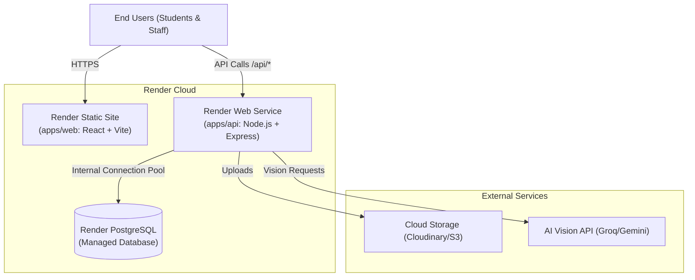

# Render Deployment Guide: SaveRaks

**Document Reference:** `docs/RENDER_DEPLOYMENT.md`  
**Date & Time:** October 28, 2026, 22:30:00 +07:00 (Asia/Bangkok)  
**Author:** Technical Lead & Principal DevOps Engineer  
**Status:** Approved Deployment Architecture  

---

## 1. Deployment Topology on Render

SaveRaks is deployed across three synchronized services on **Render Cloud**:



---

## 2. Service Specifications

### 2.1 Render Static Site (`apps/web`)
- **Service Type:** Static Site
- **Build Command:**
  ```bash
  pnpm install --frozen-lockfile && pnpm --filter @saveraks/shared build && pnpm --filter @saveraks/web build
  ```
- **Publish Directory:** `apps/web/dist`
- **Routing Rules (SPA Catch-All):**
  - Path: `/*`
  - Action: `Rewrite`
  - Destination: `/index.html`
- **Environment Variables:**
  - `VITE_API_URL`: Public HTTPS URL of the Render Web Service (e.g., `https://saveraks-api.onrender.com`).
  - `VITE_GOOGLE_CLIENT_ID`: Public Google OAuth Client ID.
  > [!CAUTION]
  > NEVER inject `JWT_SECRET`, database passwords, or AI API keys (`GROQ_API_KEY`, `GEMINI_API_KEY`) into the Static Site environment. Vite bundles all `VITE_*` variables into public JavaScript files!

---

### 2.2 Render Web Service (`apps/api`)
- **Service Type:** Web Service (Node.js)
- **Node.js Version:** `24.19.0`
- **Health Check Path:** `/api/health`
- **Build Command:**
  ```bash
  pnpm install --frozen-lockfile && pnpm --filter @saveraks/shared build && cd apps/api && npx prisma generate && npx prisma migrate deploy
  ```
- **Start Command:**
  ```bash
  node apps/api/src/server.js
  ```
- **Environment Variables Matrix:**

| Variable Name | Required | Description / Format |
| :--- | :---: | :--- |
| `NODE_ENV` | Yes | `production` |
| `PORT` | Yes | `10000` (Render default port) |
| `DATABASE_URL` | Yes | Internal PostgreSQL connection string from Render Postgres |
| `JWT_SECRET` | Yes | Cryptographically random string ($\ge 32$ characters) |
| `STAFF_INVITE_SECRET` | Yes | Cryptographically random string ($\ge 16$ characters) |
| `CORS_ALLOWED_ORIGINS` | Yes | Comma-separated list (e.g. `https://saveraks.onrender.com`) |
| `STORAGE_PROVIDER` | Yes | `cloudinary` or `s3` |
| `CLOUDINARY_CLOUD_NAME`| Yes | Cloudinary account name |
| `CLOUDINARY_API_KEY` | Yes | Cloudinary public key |
| `CLOUDINARY_API_SECRET`| Yes | Cloudinary secret |
| `GROQ_API_KEY` | Yes | Groq Vision API key |
| `GEMINI_API_KEY` | Optional | Google Gemini Flash fallback key |
| `GOOGLE_CLIENT_ID` | Optional | Google OAuth 2.0 Web Client ID |

---

### 2.3 Render PostgreSQL Database
- **Service Type:** PostgreSQL
- **Version:** PostgreSQL 16 or 17
- **Database Name:** `saveraks`
- **Access Control:**
  - Use **Internal Database URL** for the Web Service to eliminate external network egress and enforce internal VPC security.
  - Use **External Database URL** with SSL (`sslmode=require`) exclusively for administrative tools and migrations run from outside Render.

---

## 3. Render Blueprint (`render.yaml`)

This declarative Infrastructure-as-Code manifest automates the deployment of all three services:

```yaml
services:
  # -------------------------------------------------------------------------
  # 1. Frontend Web App (Static Site)
  # -------------------------------------------------------------------------
  - type: web
    name: saveraks-web
    runtime: static
    buildCommand: pnpm install --frozen-lockfile && pnpm --filter @saveraks/shared build && pnpm --filter @saveraks/web build
    staticPublishPath: apps/web/dist
    routes:
      - type: rewrite
        source: /*
        destination: /index.html
    envVars:
      - key: VITE_API_URL
        fromService:
          type: web
          name: saveraks-api
          property: host
      - key: VITE_GOOGLE_CLIENT_ID
        sync: false

  # -------------------------------------------------------------------------
  # 2. Backend API (Web Service)
  # -------------------------------------------------------------------------
  - type: web
    name: saveraks-api
    runtime: node
    plan: starter
    buildCommand: pnpm install --frozen-lockfile && pnpm --filter @saveraks/shared build && cd apps/api && npx prisma generate && npx prisma migrate deploy
    startCommand: node apps/api/src/server.js
    healthCheckPath: /api/health
    envVars:
      - key: NODE_ENV
        value: production
      - key: DATABASE_URL
        fromDatabase:
          name: saveraks-db
          property: connectionString
      - key: JWT_SECRET
        generateValue: true
      - key: STAFF_INVITE_SECRET
        generateValue: true
      - key: CORS_ALLOWED_ORIGINS
        fromService:
          type: web
          name: saveraks-web
          property: host
      - key: STORAGE_PROVIDER
        value: cloudinary
      - key: CLOUDINARY_CLOUD_NAME
        sync: false
      - key: CLOUDINARY_API_KEY
        sync: false
      - key: CLOUDINARY_API_SECRET
        sync: false
      - key: GROQ_API_KEY
        sync: false
      - key: GEMINI_API_KEY
        sync: false

# ---------------------------------------------------------------------------
# 3. Managed PostgreSQL Database
# ---------------------------------------------------------------------------
databases:
  - name: saveraks-db
    databaseName: saveraks
    user: saveraks_user
    plan: starter
```

---

## 4. Production Deployment & Zero-Downtime Protocol

### 4.1 Deployment Order
1. **Database Migrations:** The API build script executes `npx prisma migrate deploy` before launching the new server process. If a migration fails, the build halts immediately, preventing broken code from deploying.
2. **Web Service Spin-Up:** Render launches the new container and performs HTTP polling on `/api/health`.
3. **Traffic Cutover:** Only when `/api/health` returns HTTP 200 is traffic routed to the new container. The previous container is then terminated.
4. **Static Site Refresh:** `saveraks-web` builds and synchronizes to the global CDN.

### 4.2 Health Check Endpoint Specification (`/api/health`)
The endpoint verifies database connectivity and system status:
```javascript
// apps/api/src/routes/health.routes.js
import { Router } from 'express';
import { prisma } from '../config/prisma.js';

export const healthRouter = Router();

healthRouter.get('/health', async (req, res) => {
  try {
    // Perform light query to verify DB connection pool is active
    await prisma.$queryRaw`SELECT 1`;
    res.status(200).json({
      status: 'healthy',
      database: 'connected',
      uptime: process.uptime(),
      timestamp: new Date().toISOString(),
    });
  } catch (error) {
    res.status(503).json({
      status: 'unhealthy',
      database: 'disconnected',
      error: error.message,
    });
  }
});
```

---

## 5. Pre-Flight Verification Checklist Before Initial Live Deploy

- [ ] `DATABASE_URL` is configured and points to a reachable PostgreSQL instance.
- [ ] Prisma migrations successfully tested locally on a PostgreSQL test instance.
- [ ] `JWT_SECRET` generated with at least 32 cryptographically random bytes.
- [ ] `STAFF_INVITE_SECRET` established and securely recorded for faculty onboarding.
- [ ] `CORS_ALLOWED_ORIGINS` explicitly matches the Web static domain.
- [ ] Cloud object storage credentials (Cloudinary or AWS S3) tested with test image upload.
- [ ] `GROQ_API_KEY` active and rate-limit quota verified.
- [ ] Google OAuth Client ID authorized with Render domains.
