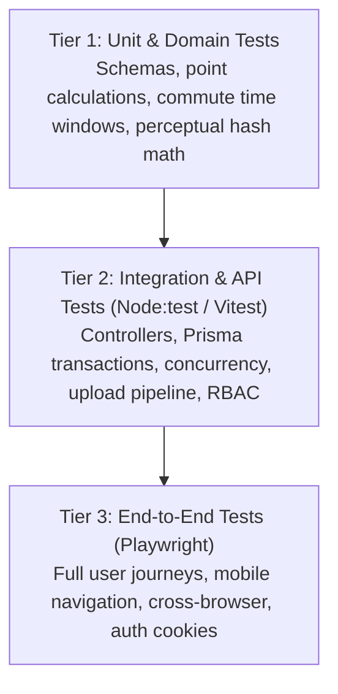

# Test Plan & Quality Assurance: SaveRaks

**Document Reference:** `docs/TEST_PLAN.md`  
**Date & Time:** October 28, 2026, 22:30:00 +07:00 (Asia/Bangkok)  
**Author:** Technical Lead & Principal QA Engineer  
**Status:** Approved Quality Assurance Strategy  

---

## 1. Quality Strategy & Testing Pyramid

The SaveRaks verification strategy enforces correctness, data integrity, security boundaries, and user experience across three automated testing tiers:



### Core Testing Mandate
- **No Fictional Test Results:** Never state or assume that tests, builds, or migrations succeeded without running the actual execution commands and inspecting the output.
- **Strict Boundary Testing:** Every security boundary (role permissions, file upload constraints, anti-cheat limits, point deductions) must have both positive (happy path) and negative (adversarial) test coverage.

---

## 2. Test Suite Matrix & Acceptance Criteria

### Suite A: Authentication & Identity
| Test ID | Test Scenario | Expected Outcome | Verification Tier |
| :--- | :--- | :--- | :--- |
| **AUTH-01** | Student registers with valid unassigned `studentId` | `201 Created`, user created, `StudentsMaster.isRegistered` set to `true`, JWT issued. | Integration |
| **AUTH-02** | Student attempts registration with already registered `studentId` | `409 Conflict`, error message: "Student ID already registered". | Integration |
| **AUTH-03** | Student attempts registration with non-existent `studentId` | `404 Not Found` or `400 Bad Request`. | Integration |
| **AUTH-04** | Staff registers with correct `staffInviteCode` | `201 Created`, user created with `STAFF` role. | Integration |
| **AUTH-05** | Staff registers with incorrect `staffInviteCode` | `401 Unauthorized`, constant-time rejection. | Integration |
| **AUTH-06** | Login with incorrect password | `401 Unauthorized`, generic "Invalid identifier or password". | Integration |
| **AUTH-07** | Rate limit on auth endpoints exceeds 5 attempts | `429 Too Many Requests`. | Integration |
| **AUTH-08** | Google SSO with valid token | `200 OK`, user profile returned, session cookie set. | Integration |

### Suite B: Action Evidence & Anti-Cheat Pipeline
| Test ID | Test Scenario | Expected Outcome | Verification Tier |
| :--- | :--- | :--- | :--- |
| **ACT-01** | Submit valid PET bottle photo with clean metadata | `201 Created`, action marked `APPROVED`, points awarded to user, ledger entry created. | Integration |
| **ACT-02** | Upload non-image file (e.g. `.exe` or `.txt`) | `400 Bad Request`, upload rejected by MIME magic-byte validator. | Integration |
| **ACT-03** | Upload image larger than 5 MB | `413 Payload Too Large` or `400 Bad Request`. | Integration |
| **ACT-04** | Submit identical duplicate image (Hamming distance $\le 5$) | Action automatically marked `REJECTED`, 0 points awarded, duplicate reason recorded. | Integration / Unit |
| **ACT-05** | Submit near-duplicate image (Hamming distance $\le 10$) | Action saved with status `PENDING`, flagged for staff review. | Integration / Unit |
| **ACT-06** | Commute submission on Saturday or Sunday | `400 Bad Request`, "Commute actions are only valid Monday–Friday". | Unit / Integration |
| **ACT-07** | Commute submission outside approved time windows | `400 Bad Request`, "Commute actions must be submitted during school commute windows". | Unit / Integration |
| **ACT-08** | Second commute submission in the same morning window | `400 Bad Request` (database unique constraint on `commuteWindowKey` triggered). | Integration |
| **ACT-09** | Action cooldown: submit 2 actions within 30 seconds | `429 Too Many Requests`, "Please wait before submitting another action". | Integration |

### Suite C: Marketplace Concurrency & Ledger Integrity
| Test ID | Test Scenario | Expected Outcome | Verification Tier |
| :--- | :--- | :--- | :--- |
| **MKT-01** | Student with 500 points purchases 200-point reward | `201 Created`, stock decremented by 1, user balance becomes 300, negative ledger row written. | Integration |
| **MKT-02** | Student with 50 points attempts to purchase 200-point reward | `400 Bad Request`, "Insufficient eco points", stock untouched. | Integration |
| **MKT-03** | Client sends tampered payload `{ rewardItemId, cost: 0 }` | Server ignores client cost; fetches true cost from DB; charges full price. | Integration |
| **MKT-04** | Attempt to purchase reward with 0 stock | `400 Bad Request`, "Reward is out of stock", points untouched. | Integration |
| **MKT-05** | **Concurrency Test:** 5 concurrent purchase requests for an item with only 1 in stock | Exactly 1 purchase succeeds (`201 Created`); 4 fail with `400 Bad Request`; stock reaches exactly 0. | Integration (Parallel) |
| **MKT-06** | Cryptographic redemption code uniqueness | Every redemption code generated matches format `SR-XXXX-XXXX` and is unique. | Unit / Integration |

### Suite D: AI Vision Service Resilience
| Test ID | Test Scenario | Expected Outcome | Verification Tier |
| :--- | :--- | :--- | :--- |
| **AI-01** | Primary Groq Vision succeeds with high confidence | Structured JSON parsed, item classified, proper bin recommended. | Integration |
| **AI-02** | Primary Groq Vision times out; fallback Gemini succeeds | Fallback executed seamlessly, output validated against Zod schema. | Integration |
| **AI-03** | Both AI services fail or network offline | System does NOT crash or auto-approve; creates submission with `PENDING` status for manual staff review. | Integration |

### Suite E: Role-Based Authorization & Admin Controls
| Test ID | Test Scenario | Expected Outcome | Verification Tier |
| :--- | :--- | :--- | :--- |
| **RBAC-01** | Student requests `GET /api/admin/evidence` | `403 Forbidden`, "Access denied: Staff or Admin role required". | Integration |
| **RBAC-02** | Staff reviews pending action and approves | Action becomes `APPROVED`, points atomically credited, reviewer ID recorded. | Integration |
| **RBAC-03** | Staff reviews pending action and rejects with reason | Action becomes `REJECTED`, points not credited, reason text saved. | Integration |
| **RBAC-04** | Admin manually adjusts student points with reason | Point balance updated, `PointTransaction` created, `AuditLog` row written with IP and actor ID. | Integration |

### Suite F: Mobile UX & End-to-End Workflows (Playwright)
| Test ID | Test Scenario | Expected Outcome | Verification Tier |
| :--- | :--- | :--- | :--- |
| **E2E-01** | Student signs up, completes AI waste scan, and views updated points | Full browser flow succeeds; UI reflects point balance without page refresh. | Playwright E2E |
| **E2E-02** | Responsive layout test across iPhone 14, Pixel 7, and Desktop | All navigation controls reachable; no horizontal overflow; touch targets $\ge 44 \times 44$ px. | Playwright E2E |
| **E2E-03** | Form validation feedback on invalid inputs | Accessible error text displayed; submit button disabled during in-flight requests. | Playwright E2E |

---

## 3. Test Tooling & Test Commands

### 3.1 Test Runners
- **Unit & Integration:** Node.js native test runner (`node:test`) or `vitest` configured in ES Module mode.
- **End-to-End:** Playwright (`@playwright/test`) configured with Chromium, WebKit, and mobile viewport presets.

### 3.2 Executable Commands
```bash
# 1. Run all Unit & Schema validation tests
pnpm --filter @saveraks/shared test

# 2. Run Backend API & Integration tests
pnpm --filter @saveraks/api test

# 3. Run Marketplace Concurrency stress tests
pnpm --filter @saveraks/api test:concurrency

# 4. Run Frontend unit/component tests
pnpm --filter @saveraks/web test

# 5. Run Playwright End-to-End tests
pnpm --filter @saveraks/e2e test:e2e

# 6. Verify full production workspace build
pnpm -r build
```
